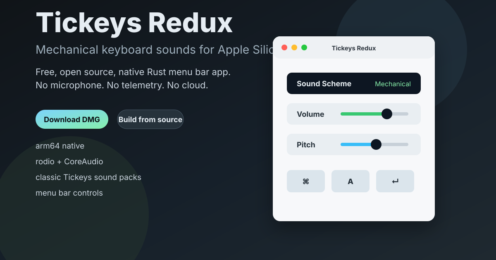

# Tickeys Redux

Native Apple Silicon menu bar app with local typing sounds for modern macOS.

[English](README.md) | [中文](README_zh-CN.md)



**Free, open source, local-only. No microphone. No telemetry. No cloud.**

**Source version: 1.0.8.** Implementation is complete in this tree; official signing and publication have not been performed. See [v1.0.8 notes and remaining acceptance checks](docs/release-v1.0.8.md).

[Download from Releases](https://github.com/E-R-Butch/TickeysRedux/releases) · [Build from source](#building-the-app-bundle) · [中文说明](README_zh-CN.md)

Tickeys Redux is a modern macOS port of [Tickeys](https://github.com/yingDev/Tickeys) by Ying Yuandong. It keeps the playful typing feedback of the original app, but rebuilds the runtime for Apple Silicon with Rust, objc2, rodio, CoreAudio, a menu-bar controller, and a native Preferences window.

> **Apple Silicon only.** This project targets arm64 Macs. Intel Mac users should use the [original Tickeys](https://github.com/yingDev/Tickeys).

## Why Try It

- **Instant typing feedback** with eight bundled schemes: Bubble, Drum, Mechanical, Synth Click, Synth Thock, Synth Space, Synth Blades, and Synth Typewriter. The five synthetic packs replace 32 recordings whose redistribution terms could not be established; the other 21 recordings retain their original licenses.
- **Native controls**: switch schemes, adjust volume and pitch from the menu bar, or use the three-tab Preferences window.
- **Privacy-respecting by design**: uses macOS Input Monitoring to detect key events, not a microphone.
- **No background web services**: no telemetry, cloud sync, analytics, or update beacon.
- **Modern native stack**: Rust 2024, objc2, rodio, CoreAudio, and an auditable app bundle script.
- **Classic Tickeys spirit**: preserves the original fun while removing legacy dylib dependencies.

## Demo

The app lives quietly in the menu bar. Pick a sound scheme, set volume and pitch, then type. Each key-down event plays a short local WAV sample immediately. Preferences also contains Sound, General, and About tabs.

```text
Menu bar -> Sound Scheme -> Bubble / Drum / Mechanical / Synth Click
                           Synth Thock / Synth Space / Synth Blades / Synth Typewriter
Menu bar -> Volume       -> 25% / 50% / 75% / 100%
Menu bar -> Pitch        -> 0.5x / 0.75x / 1.0x / 1.5x / 2.0x
```

## Install

Download the latest `.dmg` from [Releases](https://github.com/E-R-Butch/TickeysRedux/releases), open it, and copy `Tickeys Redux.app` to Applications.

Official releases use a persistent, free self-signed identity—not a paid Apple Developer ID—and are not notarized. If macOS blocks the first launch, try opening the app once, then go to **System Settings → Privacy & Security**, scroll to Security, click **Open Anyway**, and confirm **Open**. Administrator-managed Macs may not allow this override.

On first launch, grant **Input Monitoring** permission when macOS asks. Tickeys Redux uses key codes to choose local sound samples; it does not log or persist typed text, reconstruct text content, or transmit input events, and it does not use the microphone. In v1.0.8, returning to the app or opening Preferences rechecks access. Preferences shows monitoring status and a link to the relevant System Settings page. If access remains stale after an upgrade, use that page to repair the permission entry.

## What's New in v1.0.8 Source

- Input Monitoring is rechecked on launch, activation, opening Preferences, wake, and event-tap invalidation. Failed re-enabling schedules a rebuild on the main thread after the callback returns. The system permission request runs at most once per process launch; recovery does not block Preferences with an app modal.
- Menu and Preferences share one state. The window displays fractional volumes and the full `0.25x–2.0x` pitch range, plus audio/input status and **Test Sound** without keyboard permission.
- A latest-settings mailbox is separate from the bounded key queue. Schemes decode in the background, overlapping sounds share PCM buffers, and stale key events are discarded.
- Versioned percentage preferences preserve ambiguous old low values rather than amplifying them. If an old fractional menu setting is too quiet, select the intended volume again.
- About is localized in English and Simplified Chinese, with five working links; LICENSE and third-party notices open the bundled offline files.
- **Five packs now use 32 original synthetic WAVs.** Existing scheme IDs and key mappings stay compatible. Bubble, Mechanical and Drum retain 21 licensed recordings. The old Star Wars and real Cherry recordings are not included in v1.0.8. See [asset credits](docs/audio-assets.md).
- Packaging includes dependency/audio/runtime licenses, checks source and resource identity, and writes each build to a fresh directory. Official releases require an annotated version tag, clean tree and the original pinned certificate.

### Known limits and acceptance status

The lifecycle and release policies have automated regression coverage; actual permission grant/revocation, global-key capture, sleep/wake and menu/window interaction still require acceptance on a real Mac. Asynchronous CoreAudio device or route changes may still require a relaunch; v1.0.8 does not add a verified hot-plug recovery feature. Runtime sound-pack import remains planned. Hosted CI and official signing/publication are tracked separately in the [verification record](docs/development-audio-settings.md).

## Position Against Original Tickeys

The comparison baseline is the original author's final published macOS release, [Tickeys 1.1.0](https://www.yingdev.com/projects/tickeys), not only the older source snapshot visible on GitHub. Redux modernizes the runtime and permission model, but v1.0.8 has not yet restored every original user-facing feature.

| Capability | Original macOS 1.1.0 | Redux 1.0.8 source |
|---|---|---|
| **Platform/runtime** | Intel-era release | **Apple Silicon native** |
| **Permissions** | Accessibility | **Input Monitoring only** |
| **Settings** | Preferences UI and status-bar controls | **Three-tab Preferences** and menu-bar controls |
| **Core controls** | Scheme, volume, pitch, quick enable/disable | Scheme, volume, manual pitch; quick toggle pending |
| **App filtering** | Current-app exclusion and black/white lists | Pending |
| **Key-event options** | Optional modifier and synthetic-key sounds | Pending |
| **Automatic pitch** | Typing-speed-based pitch | Pending |
| **Hidden-icon recovery** | Global modifier-key sequence | Reopen the app; global gesture pending |
| **Custom schemes** | [Manual app-resource editing](https://github.com/yingDev/Tickeys#add-custom-schemes), documented in the public source release | Developer-only source customization; safe runtime import pending |
| **Update checking** | Built in | No background update beacon by design; user-initiated check planned |
| **macOS support** | 10.15+; 10.14 allowed but untested | 13+ |

The parity and beyond-original work is tracked in [ROADMAP.md](ROADMAP.md).

The original public 0.5 source uses OpenAL + libalut; Redux replaces that stack with rodio + CoreAudio. The original 1.1.0 release notes do not publish its internal audio-engine version.

## Usage

1. Launch `Tickeys Redux.app`
2. Grant **Input Monitoring** permission when the system prompt appears
3. Click 🎹 in the menu bar, or open **Preferences**, to:
   - Switch among all eight sound schemes
   - Adjust volume (25%/50%/75%/100%)
   - Adjust pitch (menu presets 0.5x–2.0x; Preferences 0.25x–2.0x)
4. Start typing — instant key sounds

## Building the App Bundle

Requires an Apple Silicon Mac, macOS 13+, Command Line Tools, Rust 1.85+ and Python 3.

```sh
git clone https://github.com/E-R-Butch/TickeysRedux.git
cd TickeysRedux
./scripts/package_app.sh
# Optional local debug build:
./scripts/package_app.sh --debug
# Optional local DMG (requires create-dmg):
./scripts/package_app.sh --dmg dist/Tickeys.Redux.v1.0.8.local.dmg
```

Each successful build prints its new path under `dist/builds/v<version>-<commit>-<profile>-<mode>-<random>/Tickeys Redux.app`; previous builds remain intact. `--dmg` also accepts no path, using the versioned local filename in `dist/`. An existing DMG is never overwritten.

The script builds arm64 for macOS 13, assembles resources and language metadata, copies project/dependency/audio and build-toolchain Rust runtime licenses, records the source commit, ad-hoc signs by default, and verifies the bundle. A plain `cargo build` creates a binary, not an installable App Bundle.

For official artifacts, `scripts/package_release.sh` requires a clean checkout, an annotated `v1.0.8` tag pointing to HEAD, and the existing signing certificate/private key on the maintainer's original signing Mac. It pins both certificate SHA-1 and SHA-256, verifies the App inside ZIP and DMG, writes checksums/build metadata, and refuses to replace an existing release. See [signing policy](docs/signing.md); no new identity or paid Developer ID is required.

### Verification

```sh
cargo fmt --all -- --check
cargo test --all-targets --locked
cargo clippy --all-targets --locked -- -D warnings
python3 scripts/generate_audio_assets.py --check
python3 scripts/generate_notices.py --check
python3 -m unittest discover -s scripts/tests -v
```

See the [verification record](docs/development-audio-settings.md) for completed checks and manual acceptance limits.

## Developer-only Custom Sound Schemes

Runtime import is not implemented. Do not modify an installed signed App Bundle: that changes its code signature and may affect Input Monitoring. For a source customization, add WAVs under `assets/data/`, define the scheme in `assets/data/schemes.json`, and register its author/license policy in `scripts/generate_audio_assets.py` so the complete audio manifest can be regenerated and checked.

```json
{
    "name": "myScheme",
    "display_name": "My Scheme",
    "files": ["1.wav", "2.wav", "3.wav"],
    "non_unique_count": 3,
    "key_audio_map": {}
}
```

`name` must match the sound directory. `display_name` is the fallback when no localization exists. Keep [audio credits](docs/audio-assets.md), per-pack licenses and generated manifests consistent before packaging. Safe import from Application Support remains on the [Roadmap](ROADMAP.md).

## Tech Stack

| Component | Library | Purpose |
|---|---|---|
| Audio | rodio 0.20 | WAV decode + playback via CoreAudio |
| UI | objc2 0.6 | NSStatusBar, NSMenu, NSAlert |
| Keyboard | CGEventTap (FFI) | Global key-down monitoring |
| Concurrency | crossbeam-channel 0.5 | Bounded key queue and settings wake-up channel |
| Config | serde + serde_json | Scheme definition parsing |
| Prefs | NSUserDefaults | Persist scheme/volume/pitch |

## Permissions

Tickeys Redux uses `CGEventTapCreate` to receive global key-down key codes and select local sound samples. This requires **Input Monitoring** permission on macOS. The app does not log events to disk or transmit them. When access is missing, the system request is attempted at most once per process launch. Preferences stays usable and provides status, Test Sound and a System Settings link. Activation, reopening Preferences and wake trigger a fresh access check. No Accessibility permission is needed.

On Apple Silicon, `cargo build` produces a linker-signed ad-hoc Mach-O, not the project's persistent release identity. `scripts/package_app.sh` ad-hoc signs the complete local app bundle by default, so rebuilding it may require Input Monitoring permission again. Official releases from v1.0.7 onward use the persistent self-signed identity documented in [docs/signing.md](docs/signing.md). Upgrading from an older ad-hoc release requires one permission repair; later releases signed with the same identity can retain it.

Start at Login uses Apple's `SMAppService` API and therefore requires macOS 13 or later. The app surfaces any registration error from macOS instead of silently showing a checked box.

## Project Metadata

Suggested GitHub topics are listed in [docs/github-metadata.md](docs/github-metadata.md).

## License and Sound Assets

The Redux source code is MIT licensed. Original work by [应元东](https://github.com/yingDev); Redux port by [Sinclair](https://github.com/E-R-Butch). The 21 retained recordings use CC BY 3.0 or CC0; the 32 new synthetic WAVs use the project MIT license. Full [audio provenance](docs/audio-assets.md), [dependency notices](THIRD_PARTY_NOTICES.md), and license texts are bundled for offline access. The dependency inventory covers 46 target-resolved normal/build packages and 103 notice/license files; Rust runtime notices come from the actual build toolchain.
